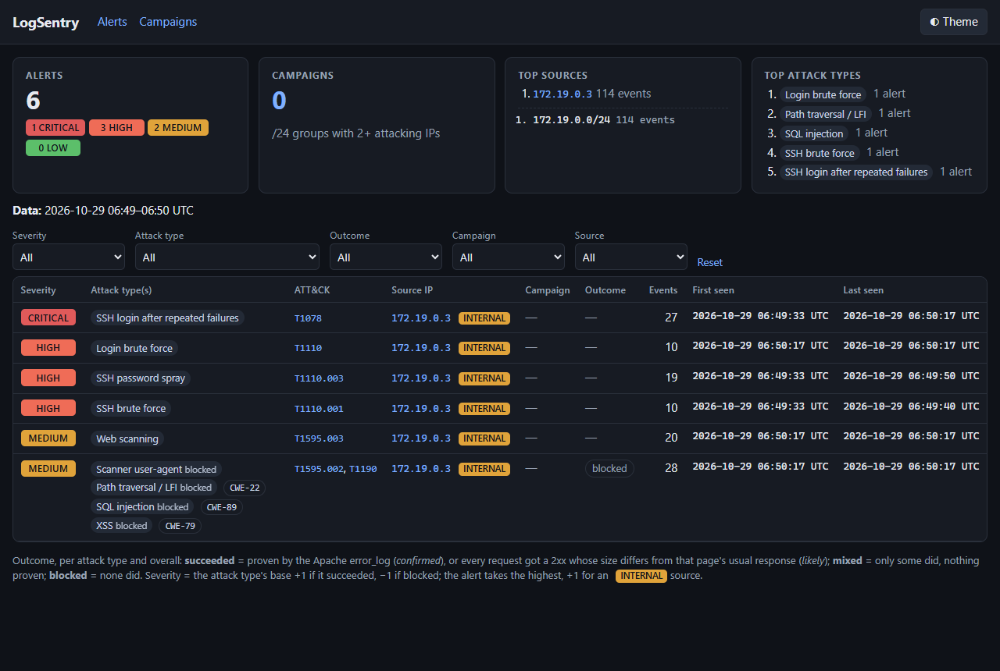
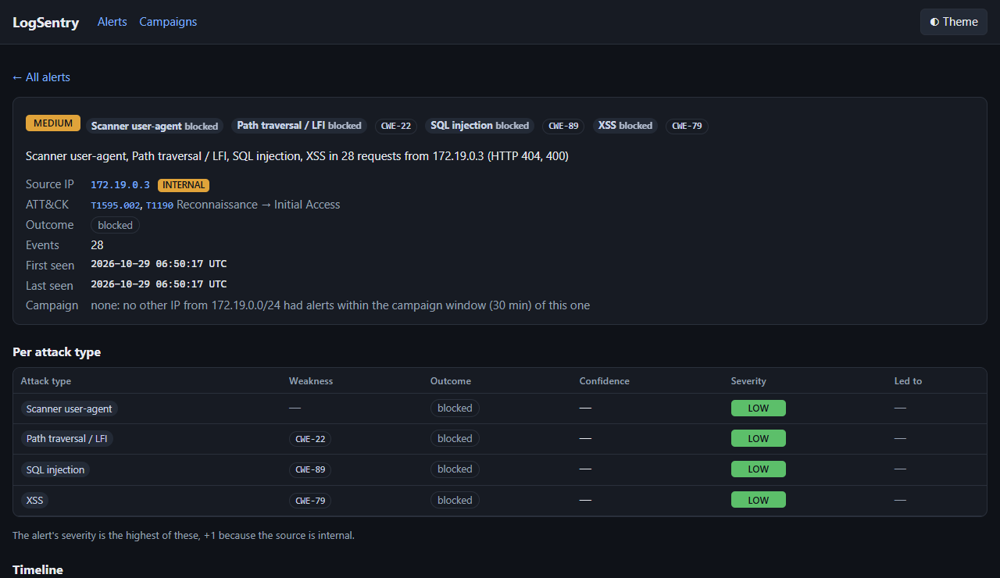
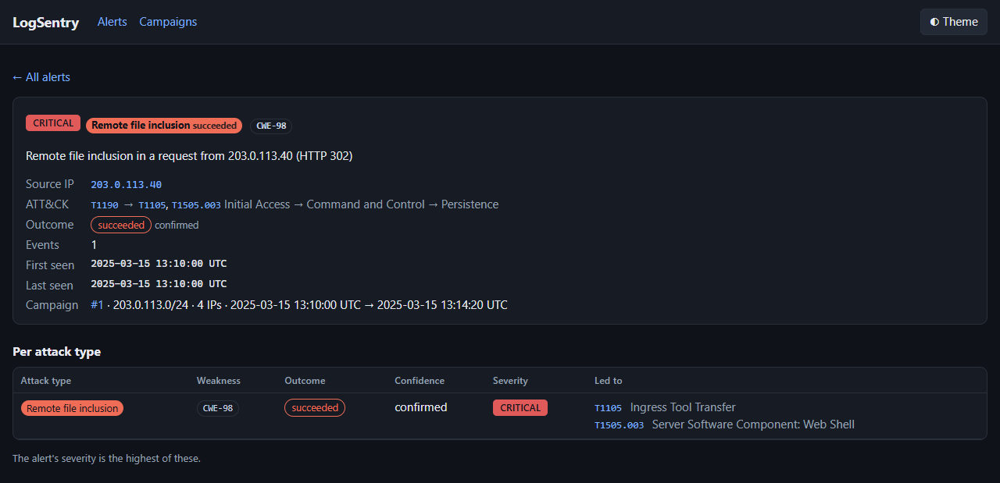
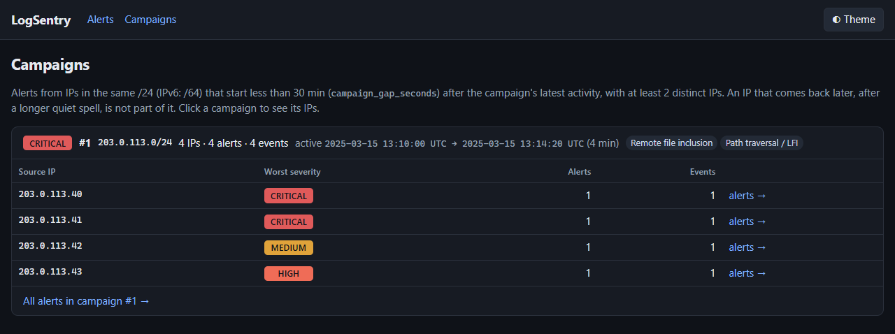
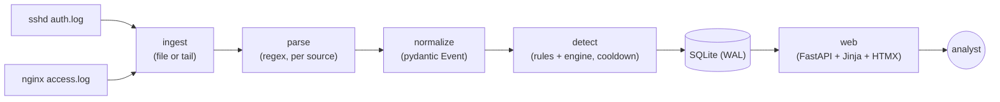

# LogSentry

Lightweight intrusion detection for sshd auth logs and nginx access logs. Six detection rules, each mapped to MITRE ATT&CK, stored in SQLite and shown on a small web dashboard. A Docker lab (victim + attacker + LogSentry) shows it catching real attacks end to end.


| Dashboard after `make attack` | An alert's detail page |
|---|---|
| [](docs/dashboard.png) | [](docs/alert-detail.png) |
| **A confirmed RFI and its follow-on chain** | **A /24 campaign** |
| [](docs/success-chain.png) | [](docs/campaign.png) |

## The problem

A Linux box exposed to the internet sees SSH brute force and web scanners within minutes. The evidence is already in `auth.log` and nginx's `access.log`, but nobody reads those files line by line. Big tools (Wazuh, Elastic, Splunk) solve this, but they are heavy and opaque. LogSentry does the core job in a few hundred lines of plain Python, where every detection can be read, explained and tested.

## How it works



- **Two processes, one image.** `logsentry tail` is the only writer; `logsentry web` only reads. They share nothing but the SQLite file, so the process facing the network never touches the logs.
- **Event time, not wall-clock time.** Sliding windows use the timestamp from the log line, so replaying a file gives the same alerts as running live, and the tests are deterministic.
- **One rule = one module** in `src/logsentry/rules/`, with its ATT&CK mapping, a pydantic config model, and `process(event) -> list[Alert]`. Thresholds live in `config/rules.yaml` (validated, unknown keys rejected).
- **One web alert per attacking IP** while its requests are less than 30 min apart, and **campaigns** tying together IPs of one /24 attacking at the same time. Other rules use a cooldown per `(rule, IP)`, so one brute force produces one alert, not 500.

## Detections

| Rule | Logic (defaults) | ATT&CK technique | Tactic | Severity |
|---|---|---|---|---|
| `ssh_bruteforce` | ≥10 failed logins from one IP in 60 s | [T1110.001](https://attack.mitre.org/techniques/T1110/001/) Password Guessing | Credential Access | medium |
| `password_spray` | ≥5 distinct usernames failing from one IP in 300 s | [T1110.003](https://attack.mitre.org/techniques/T1110/003/) Password Spraying | Credential Access | medium |
| `success_after_failures` | a successful login from an IP with ≥5 failures in the previous 600 s | [T1078](https://attack.mitre.org/techniques/T1078/) Valid Accounts | Initial Access | high |
| `web_scan` | ≥20 404s from one IP in 60 s | [T1595.003](https://attack.mitre.org/techniques/T1595/003/) Wordlist Scanning | Reconnaissance | low |
| `web_attack` | attack patterns in each request, one alert per category (see below) | per category | per category | per category |
| `web_login_bruteforce` | ≥10 POSTs to a login page (`wp-login.php`, `/login`, …) from one IP in 60 s | [T1110](https://attack.mitre.org/techniques/T1110/) Brute Force | Credential Access | medium |

**Severity adjustments (every rule):** a source in RFC 1918 / IPv6 ULA space is tagged **internal** and its alert gets +1 level (the attacker is already inside). `web_attack` also moves each category's severity up or down by whether it worked (see *Did it work?* below).

All thresholds, the cooldown (300 s), the web alert gap (`web_attack.group_gap_seconds`, 30 min) and the campaign window (`campaign_gap_seconds`, 30 min) are in [`config/rules.yaml`](config/rules.yaml).

**Campaigns:** after each `ingest` (and each `tail` poll that stored something), alerts are grouped by /24 (IPv6: /64). Within a subnet, an alert joins the current group when it starts less than `campaign_gap_seconds` after the group's latest activity. A group with 2 or more distinct IPs is a campaign, stored with its subnet, number of distinct IPs, categories and time span; the dashboard shows it next to each alert.

### Web attack categories

`web_attack` checks each request's URL path and query, **percent-decoded twice** (so `%252e%252e%252f` is caught), and its User-Agent. All the attack requests from one IP go into **one alert** while they keep coming less than `group_gap_seconds` (30 min) apart; a longer quiet spell starts a new alert. The alert lists every category it contains (say *SQL injection, XSS*), all their ATT&CK techniques, and its count, first and last seen. With `tail`, the stored row is updated as the attack goes on; the phone is notified when the alert opens and again only if its severity goes up.

| Category (`rule_id`) | Looks for | ATT&CK | Base severity |
|---|---|---|---|
| SQL injection (`web_attack.sqli`) | `union select`, `' or 1=1`, `sleep(`, `benchmark(`, `information_schema`, `'--` | [T1190](https://attack.mitre.org/techniques/T1190/) Exploit Public-Facing Application | medium |
| XSS (`web_attack.xss`) | `<script`, `<svg`, `<img`, `onerror=`, `onload=`, `javascript:`, `alert(` | T1190 | medium |
| Path traversal / LFI (`web_attack.path_traversal`) | `../`, `..%2f`, `/etc/passwd`, `php://`, `file://` | T1190 | medium |
| Remote file inclusion (`web_attack.rfi`) | a parameter holding a URL to a script (`?page=http://…/x.php`) | T1190 | high |
| Command injection (`web_attack.command_injection`) | `;id`, `\|whoami`, `$(`, backticks, `/bin/sh`, `cmd.exe` | T1190 | high |
| Log4Shell / Shellshock (`web_attack.log4shell_shellshock`) | `${jndi:`, nested `${${`, `() {`, in the URL or User-Agent | T1190 | critical |
| Sensitive file probing (`web_attack.sensitive_file`) | `.env`, `.git/`, `wp-config`, `.htaccess`, `/phpmyadmin`, backup files | [T1595.003](https://attack.mitre.org/techniques/T1595/003/) Wordlist Scanning | low |
| Scanner user-agent (`web_attack.scanner_ua`) | sqlmap, nikto, nmap, gobuster, dirbuster, wpscan, zgrab, masscan, ffuf | [T1595.002](https://attack.mitre.org/techniques/T1595/002/) Vulnerability Scanning | low |

**Weakness and follow-on techniques.** Each category also names its CWE (path traversal CWE-22, command injection CWE-78, RFI CWE-98, SQLi CWE-89, XSS CWE-79), and lists the techniques its *success* leads to. The dashboard shows them as a chain, e.g. `T1190 → T1105`:

| Category succeeded | Adds | Only when a request that worked… |
|---|---|---|
| Command injection | T1059 Command and Scripting Interpreter | |
| | T1059.004 Unix Shell | runs a Unix shell command (`;id`, `$(…)`, `/bin/sh`) |
| Remote file inclusion | T1105 Ingress Tool Transfer | |
| | T1505.003 Web Shell | includes a file named like a shell (`c99`, `shell*.php`, …) or calls `system(`/`exec(`/`eval(` |
| Path traversal / LFI | T1083 File and Directory Discovery | |
| | T1552.001 Credentials In Files | reads `.env`, `wp-config.php`, `config.php`, `id_rsa`, `/etc/shadow` |

The mappings live in `web_patterns.yaml` (`cwe`, `follow_on`, and an optional `when` regex). Only the request is logged, never the included file's content, so the web-shell check goes by the file's name and the request alone.

**Did it work?** Each category in an alert gets a result from its requests:

| Result | When | Severity |
|---|---|---|
| succeeded, *confirmed* | the Apache error_log proves an inclusion worked (`ingest --error-log`) | base + 1 |
| succeeded, *likely* | every request got a 2xx whose size differs from that page's usual response | base + 1 |
| mixed, *likely* | only some did, nothing proven: not counted as a success | base |
| blocked | none did (a 2xx the usual size of the page is an ordinary page view) | base − 1 |

The alert takes its highest category (kept between low and critical), so a succeeded RFI or command injection is critical; an internal source then adds +1. The usual page sizes and the error_log are only known to `ingest`; `tail` judges by status alone.

**Evidence:** for each request an alert covers, it stores the time, HTTP status, pattern id and the text that matched (control characters stripped, 100 characters max). The alert page shows them in a *Matched* table.

**Adding a pattern:** categories, ATT&CK IDs, severities and regexes live in [`config/web_patterns.yaml`](config/web_patterns.yaml), not in code. Add a line under a category:

```yaml
      - {id: xp_cmdshell, field: request, regex: '\bxp_cmdshell\b'}
```

`field` is `request` (the decoded path and query) or `user_agent`, and regexes are case-insensitive. One field per pattern keeps each one a single Sigma selection (`field|re:`) for a later export. A bad regex or unknown field stops LogSentry at startup. `uv run pytest tests/test_web_classify.py` runs the attack and benign sample lines.

## Run it

Requirements: Python 3.12 + [uv](https://docs.astral.sh/uv/) for the CLI; Docker with Compose for the lab.

**Offline, on a log file:**

```bash
uv sync
uv run logsentry ingest tests/fixtures/auth_bruteforce.log --source sshd
uv run logsentry web          # http://127.0.0.1:8000
```

**Did a file-inclusion attack work?** Give `ingest` the Apache `error_log` next to the access log:

```bash
uv run logsentry ingest tests/fixtures/apache_access_campaign.log --source nginx   --error-log tests/fixtures/apache_error_campaign.log
```

For each RFI / path-traversal request, PHP's error_log decides whether it worked:

| Request verdict | When |
|---|---|
| `failed` | PHP logged `failed to open stream` / `Failed opening … for inclusion` for that IP within 10 s (`outcome_window_seconds`) |
| `succeeded` | the error_log was being written at that time and logged no such error |
| `unknown` | the error_log doesn't cover the request's time, or the script isn't PHP |

These verdicts don't set the severity themselves: a `succeeded` or `failed` verdict becomes that request's *confirmed* result in the *Did it work?* table above, which is what moves the severity. The alert also shows an overall error_log outcome (succeeded if any request did, failed only if all did, otherwise unknown) with its evidence, on the alert page and in the CLI output. The error_log has no time zone, so it's read in the access log's offset. The response size compared with the page's usual size is listed as supporting evidence only. Malformed error_log lines are counted and reported.

**Live, in the lab:**

```bash
cp .env.example .env          # lab-only password for the target's weak account
make lab                      # target (sshd + nginx) + logsentry-tail + logsentry-web
make attack                   # runs the 6 attack scenarios against the target
# open http://127.0.0.1:8000 — all six rule types show up within a minute
make down
```

**On your own server (Debian/Ubuntu):**

```bash
git clone https://github.com/Shamonzen/logsentry && cd logsentry
sudo ./install.sh              # sets everything up, offers phone alerts, runs a health check
sudo logsentry doctor          # plain-language health check, any time
journalctl -u logsentry-tail -f   # alerts as they happen
```

The installer creates an unprivileged `logsentry` user (in group `adm` to read the logs), installs the two hardened systemd services from `deploy/systemd/`, and starts them. For phone alerts it generates a secret [ntfy](https://ntfy.sh) topic, shows a QR code and sends a test notification; after that every HIGH alert is pushed as it happens, plus a summary of the last 24 hours every morning at 08:00 (`logsentry summary`, run by a systemd timer). Update with `git pull && sudo ./install.sh`; remove with `sudo ./install.sh --uninstall`. The dashboard has no login and only listens on 127.0.0.1: reach it with `ssh -L 8000:127.0.0.1:8000 <server>`.

**Tests:**

```bash
uv run ruff check . && uv run ruff format --check .
uv run pytest                 # unit tests: every parser and rule has attack + benign fixtures
uv run pytest -m e2e          # needs the lab running; polls /api/alerts until every rule fires
```

## The lab

- The `lab` Docker network is `internal: true`: it has **no route to the internet**. Only `target` and `attacker` are on it. You can check: `docker compose run --rm --entrypoint curl attacker -m3 https://example.com` must fail.
- `attacker` (hydra, nmap, nikto, curl) sits behind the `attack` compose profile, so `make lab` doesn't start it. Every scenario calls `guard_target` first: the target must be the hostname `target` and resolve inside the lab subnet, or the script exits.
- `logsentry-tail` runs with `network_mode: none` and mounts the logs read-only. `logsentry-web` is on a separate network and publishes only `127.0.0.1:8000`.
- LogSentry containers run as `USER 10001`, `read_only: true`, `cap_drop: [ALL]`, `no-new-privileges`.
- **The exception:** `target` runs as root, because sshd needs it. It is the deliberate victim, with one deliberately weak account whose password comes from `.env`, never from code.

## Threat model

An IDS reads attacker-controlled input, so the analyst tool is itself an attack surface.

| Threat | Mitigation |
|---|---|
| Stored XSS: a payload in a username or URL rendered on the dashboard | Jinja autoescape always on, strict CSP (`default-src 'self'`, HTMX vendored, no CDN), and a test that an XSS payload comes out escaped |
| SQL injection via log content | Parameterized SQL only (stdlib `sqlite3`, no string building) |
| Log injection: newlines, ANSI codes in usernames | Control characters removed; usernames capped at 64 chars |
| ReDoS from long, hostile URLs | Lines capped at 4 KB before parsing; simple regexes with no nested quantifiers |
| Spoofed `X-Forwarded-For` | Only nginx's `$remote_addr` is used as the source IP |
| Ambiguous timestamps (no year, no zone) | UTC everywhere; the lab writes RFC 3339 timestamps |
| Malicious config | `yaml.safe_load` only, pydantic validation, unknown keys rejected |
| Dashboard access | Bound to `127.0.0.1`, read-only, **no authentication**: anyone with local access can read alerts. Fine for a lab; not for a shared server |
| Supply chain | `uv.lock` pins every dependency by hash |

## False positives and limitations

**False positives**
- Many users behind one NAT or proxy look like a single IP.
- A /24 is a guess at "one operator": unrelated attackers on one cloud or ISP range can share a campaign, and one operator spread over several ranges is split.
- A user who forgot their password can trip `ssh_bruteforce` or `success_after_failures`.
- Health checks, broken links, or a stale sitemap can produce bursts of 404s (`web_scan`).
- Your own vulnerability scanners match the scanner user-agent category.
- Legitimate URLs containing text like `union select`, `<script>`, `../` or `$(` (a code-search page, a docs site) match `web_attack`.
- Many legitimate logins from one NAT can look like `web_login_bruteforce`.

**Evasion and blind spots**
- Slow-and-low or distributed brute force stays under per-IP thresholds; IP rotation defeats per-IP keys entirely.
- Payloads in the POST body are invisible: nginx doesn't log it. Triple URL encoding gets past the double decode (a leftover `..%2f` is still caught).
- Padding a URL past the 4 KB line cap makes the request get ignored.
- User-Agent matching is trivially spoofed.

**Design limits**
- Sliding-window state lives in memory: an attack spanning a restart can be missed, and it runs on one node only (old entries are dropped and the number of keys is capped).
- SQLite means one writer and no full-text search. Storage sits behind `store.py`, so it can be swapped.
- Only sshd, nginx (combined format) and IIS (W3C extended) are parsed. IIS works with `ingest` only, not `tail`. Apache `error_log` is read only by `ingest --error-log`, to judge outcomes.

## What I'd do next

- Import Sigma rules instead of only hand-written ones.
- Send alerts to Slack, email or a webhook.
- GeoIP / ASN enrichment (MaxMind GeoLite2).
- Dashboard auth + TLS, and an acknowledge / status workflow for alerts.
- Keep window state in Redis (or SQL window queries) so restarts don't lose it.
- journald ingestion; ATT&CK Navigator layer export; Prometheus metrics.
- Base images pinned by digest and a Trivy scan in CI.

## Interview notes

Five design decisions a reviewer is likely to question, with the trade-offs I weighed (full version in [`docs/PLAN.md`](docs/PLAN.md)):

1. **Hand-written Python rules, not Sigma / fail2ban / Wazuh / Elastic.** Every line can be read, explained and tested; the cost is coverage, which is why Sigma import is the first thing I'd add.
2. **Sliding windows in memory, keyed on event time.** Simple, fast and deterministic; state is lost on restart and lives on one node, bounded by dropping old entries and capping keys. Upgrade path: Redis or SQL window queries.
3. **SQLite, one writer (`tail`) plus read-only `web`.** No server to run and plenty for a lab; no full-text search and no scale-out. Storage sits behind `store.py` so it can be swapped.
4. **Thresholds and regexes are configurable** because both false positives (NAT, forgotten passwords, health checks) and evasion (slow-and-low, double encoding, POST-body payloads, IP rotation) are real; all of it is listed under *False positives and limitations*.
5. **The dashboard is itself an attack surface** — log lines are attacker-controlled. Mitigations: Jinja autoescape + CSP + an escaping test, stripped control characters, capped line length, simple regexes, `$remote_addr` only, UTC everywhere.

## License

MIT, see [LICENSE](LICENSE).
